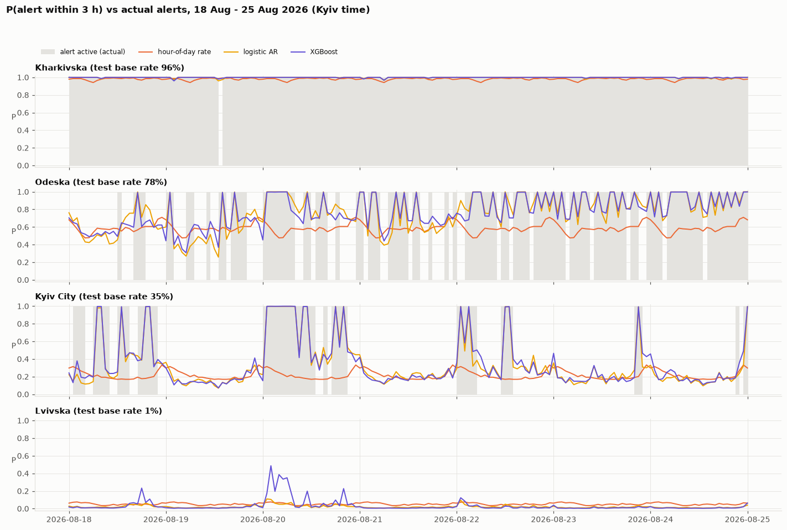

# Air raid alerts in Ukraine — time series analysis and short-term forecasting

For every oblast and every hour, the model predicts the probability that the oblast will be under an air raid alert
at some point within the next **1, 3 or 6 hours**, using only information available at the forecast time.



## Results (in short)

Evaluated on the **last 5 weeks before 4 Sep 2026** (held-out test set, 4 rolling folds), after tuning on 4 validation folds
spread over Feb–Jun 2026. Brier skill is measured against a per-oblast hour-of-day baseline (higher is better).

| h = 3 h | all hours | **quiet hours only** (will a *new* alert start?) |
|---|---|---|
| XGBoost — Brier skill, test | 0.36 | **0.19** |
| XGBoost — Brier skill, validation | 0.28 | **0.09** |
| XGBoost — mean per-oblast ROC AUC, test / validation | 0.83 / 0.83 | **0.76 / 0.72** |

* **Final model: XGBoost** (expanding training window, tuned). LightGBM is equivalent; a logistic autoregression is a close,
  interpretable runner-up and the best model in the quiet western oblasts. All of them clearly beat the baselines and the ETS family,
  with the same ranking on the validation and the test folds.
* **Most of the headline skill comes from predicting that a running alert continues** (if an alert is active now, the target is 1 in
  99.9 % of cases). For new alerts the model gives a useful but limited early warning — mainly from alerts already running in other oblasts.
* Seasonality is weak: the daily cycle is large in relative terms in the rear (up to 7× between night and day) but explains only a few
  percent of the variance; no weekly or monthly seasonality was found.

## Data — and why the evaluation stops on 4 September 2026

Source: [Vadimkin/ukrainian-air-raid-sirens-dataset](https://github.com/Vadimkin/ukrainian-air-raid-sirens-dataset) (MIT),
snapshot from 2026-10-10 committed in `data/raw/`. Finding a reliable, *current* source was the hardest part of the project:

* The **official** data (raion level) is reliable but **stopped on 2026-09-07**, because its source — the official Telegram channel
  `@air_alert_ua` — stopped posting.
* The **volunteer** data (eTryvoga) is up to date but **unreliable since 2024**: measured minute by minute against the official data,
  it covers only 31 % of official alert time in 2026, splits long alerts into short pieces, and contains spurious alerts in two oblasts
  (`notebooks/eda.ipynb`, section 1).
* Other sources were checked and rejected: APIs fed by the same stopped channel, regional administration channels (alerts are posted
  only for Lviv and Kyiv, not for the front line), alerts.in.ua (history only with a manually reviewed API token).
* On **4 Sep 2026** Ukraine introduced a two-level (yellow / red) alert system, so alerts after that date mean something different anyway.

**Decision:** use the official data from **1 Nov 2025** (raion-level alerting) to **4 Sep 2026 00:00 Kyiv** — the latest period in which
reliable data exists and "alert" has a stable meaning. An oblast counts as under alert if any oblast- or raion-level alert is active in it.

## Method

* **Features** (`ua_alerts/features.py`): the oblast's current state and recent history, regional state (national and per macro-region
  share of oblasts under alert, new alerts in the last hours), Kyiv hour of day, oblast identity.
* **Models** (`ua_alerts/models.py`): persistence, hour-of-day rate, ETS(A,N,N) / (A,N,A) / (A,A,A) / (A,Ad,A) and AutoETS (per-oblast
  AICc selection), logistic autoregression, LightGBM, XGBoost.
* **Validation** (`ua_alerts/backtest.py`, `ua_alerts/tuning.py`): rolling-origin backtest with expanding and sliding (12-week) training
  windows; training rows whose target window overlaps the evaluated fold are purged; hyperparameters are tuned on the validation folds
  only (time-based — random k-fold would leak through autocorrelated neighbouring hours); the test folds are used once.
* **No leakage**: `tests/test_leakage.py` rebuilds all features from data truncated at the forecast time and checks they are identical;
  the test was verified to fail on a deliberately injected look-ahead.

## Repository

```
data/raw/                 dataset snapshot (+ LICENSE, README with snapshot date)
notebooks/eda.ipynb       data sources and quality, trend, seasonality (STL / MSTL, ACF, periodogram), regional dependence
notebooks/model.ipynb     training and validation: tuning, test results, onset analysis, ETS experiments, per-oblast results
ua_alerts/                data loading, features, models, tuning, backtest, evaluation plots, predict
reports/figures/          all figures;  reports/tuned_params.json, tuning_results.csv
tests/test_leakage.py     leakage test
```

## How to run

Requires [uv](https://docs.astral.sh/uv/) and Python 3.13.

```bash
uv sync                                   # install dependencies
uv run python -m pytest tests             # leakage test
uv run python -m ua_alerts.eda            # EDA figures (headless)
uv run python -m ua_alerts.tuning         # hyperparameter search on validation folds (~5 min)
uv run python -m ua_alerts.backtest       # full backtest, all models (~6 min)
uv run python -m ua_alerts.predict        # final forecast at 2026-09-04 00:00 Kyiv
uv run python -m ua_alerts.predict --at "2026-08-20 03:00"   # forecast for any hour in the modelling window
```

The notebooks run end to end from `notebooks/` (`uv run jupyter notebook`); `model.ipynb` reads the cached backtest predictions
(`backtest.run_all(rerun=True)` retrains everything).

## Limitations and next steps

* The test period ends on 4 Sep 2026; under the yellow/red system the model would have to be re-trained on new data.
* The model predicts the *official alert*, not the threat itself. Results for the western oblasts rest on very few alerts.
* Early warning of **new** alerts is limited by the information in the alert history. The natural next step is text features
  published before the forecast time — Air Force reports of launches and drone movements, and reports of strategic-aviation take-offs.

---
Built with Claude Code as the primary engineering tool; the full AI conversation log is submitted separately.
